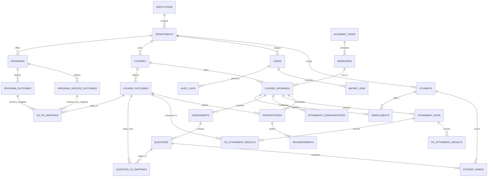

# Database Architecture & Entity Relationship Diagram

The **CO-ATTAIN PRO AI** database schema is designed for relational consistency, referential integrity, and accreditation auditability.

## Core Relational Tables

1. **`institutions`**: College/University root organization.
2. **`departments`**: Academic units (e.g. Computer Science & Engineering).
3. **`users`**: System accounts with Argon2 hashes and role-based permissions (`SUPER_ADMIN`, `HOD`, `FACULTY`, `STUDENT`).
4. **`academic_years` & `semesters`**: Temporal terms (e.g., 2024-2025, Semester 5).
5. **`programs`**: Degree programs (e.g., B.Tech CSE).
6. **`courses` & `course_offerings`**: Catalog courses and active section offerings.
7. **`students` & `enrollments`**: Registered cohorts and course registrations.
8. **`course_outcomes` (COs)**: Course competencies with Bloom's Taxonomy levels (Understand, Apply, Analyze, Create) and target percentages.
9. **`program_outcomes` (POs)** & **`program_specific_outcomes` (PSOs)**: Washington Accord PO1-PO12 and department-specific PSOs.
10. **`co_po_mappings`**: Mapping strength (0=None, 1=Low, 2=Medium, 3=High) and justification.
11. **`assessments` & `questions`**: CIE/SEE exams and individual questions with maximum marks.
12. **`question_co_mappings`**: Direct constructive alignment from exam questions to COs.
13. **`student_marks`**: Validated marks obtained, absence flags, and remarks.
14. **`attainment_configurations`**: Method A (Threshold) vs Method B (Normalized), thresholds, and direct/indirect weights.
15. **`attainment_runs` & `co_attainment_results`**: Immutable, versioned calculation snapshots recording direct, indirect, overall attainment, gaps, and severity.
16. **`po_attainment_results`**: Aggregated program-level attainment derived from CO mapping matrix.
17. **`interventions` & `reassessments`**: Closed-loop Continuous Quality Improvement (CQI) tracking and post-remedial verified improvement.
